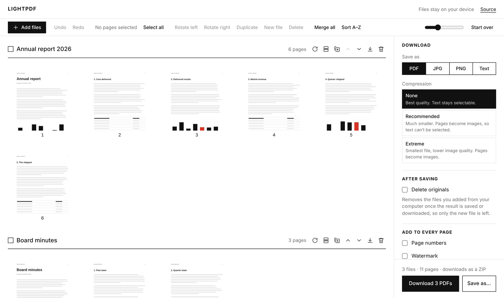

<div align="center">

<picture>
  <source media="(prefers-color-scheme: dark)" srcset="docs/images/logo-dark.svg">
  
</picture>

<p><strong>Private PDF tools that run entirely in your browser.</strong><br>
Merge, split, reorder, rotate, edit, fill in, redact, compress and convert PDFs and images. Nothing is uploaded.</p>

[](https://github.com/mohha1/LightPDF/actions/workflows/ci.yml)
[](LICENSE)
[](SECURITY.md)
[](#install-and-offline-use)

[Features](#features) · [How it works](#how-it-works) · [Privacy and security](#privacy-and-security) · [Run it offline](#run-it-offline-without-installing) · [Self-hosting](#self-hosting) · [Development](#development)

</div>

<br>

<p align="center">
  
</p>

## Why LightPDF

- **Your files stay on your device.** LightPDF is a static web app with no server-side processing, no account, no analytics and no third-party requests. Files are read, edited and written inside your browser tab.
- **One editor for everything.** Add any number of PDFs and images, see every page, and arrange them the way you want. Each document card is one output file, so what you see is what you get.
- **Keeps what matters.** A PDF whose pages you leave in order is edited in place, so its bookmarks, links, form fields and metadata survive.
- **Works offline.** After the first visit the app is cached on your device, and Chrome and Edge can install it like a desktop app.
- **Small and fast.** The app shell is about 29 KB gzipped. The PDF engines load only when you need them; MuPDF, which redacts (about 5 MB), only when a download has something to redact.

## Features

| | |
| --- | --- |
| **Organise** | Reorder, rotate, delete, duplicate and extract pages, insert blank pages. Drag pages between documents. |
| **Edit pages** | Double-click a page to add text, freehand drawing, highlights, whiteout, rectangles, ellipses, lines, arrows, stamps, ticks, dates and images, or to crop it. |
| **Redact** | Remove text, images and drawings under a box from the file for good, not just cover them. |
| **Merge and split** | Merge everything into one file, merge two neighbours, split at any page or into single pages. |
| **Compress** | Shrink scans and photo-heavy files. LightPDF never hands back a file bigger than the original. |
| **Convert** | Export to PDF, JPG, PNG or plain text. Turn JPG, PNG and other images into PDF pages. |
| **Stamp** | Add page numbers and a text watermark to every page. |
| **Forms** | Fill in a PDF's form fields, and flatten them into the page. |
| **Privacy** | See and change a file's properties (title, author…), and remove hidden data: metadata, attachments, scripts and old versions of content. |
| **Save** | Download (as a ZIP when there are several files), or **Save as…** straight to a file or folder of your choice. |
| **Tidy up** | Optionally delete the original files once the result is saved, so only the new file is left. |
| **Undo** | Every edit can be undone and redone. |

## How it works

1. **Add files.** Drop or select PDFs and images, one or many. Each file becomes a document in the editor.
2. **Arrange and edit.** Every page is shown as a thumbnail. Each document card is one file you'll download.
3. **Download or save.** Pick the format and extras in the Download panel. **Download** puts everything in your downloads folder; **Save as…** lets you choose the file name, or a folder for several files. A single document can also be downloaded from its card.

### In the editor

| To… | Do this |
| --- | --- |
| Select pages | Click pages. Shift-click selects a range, even across documents. <kbd>Ctrl</kbd>/<kbd>Cmd</kbd>+<kbd>A</kbd> selects everything. |
| Reorder or move pages | Drag pages, or a whole selection, to a new spot in any document. On touch screens, drag the dotted handle. |
| Rotate | Hover a page and use its rotate button, select pages and press <kbd>R</kbd> (<kbd>Shift</kbd>+<kbd>R</kbd> for left), or rotate a whole document from its header. |
| Delete | Hover a page and use its bin button, or select pages and press <kbd>Delete</kbd>. |
| Duplicate | Select pages and choose **Duplicate**. |
| Extract | Select pages and choose **New file** to copy them into a new document. |
| Split | Click the scissors between two pages, or **Split into single pages** in a document's header. |
| Merge | **Merge all** in the toolbar, **Merge with the next file** in a document's header, or drag pages from one document into another. |
| Rename | Click a document's name. The name becomes the file name. |
| Edit a page | Double-click it, hover it and use its pencil button, or select it and press <kbd>E</kbd> or **Edit page**. See below. |
| Insert a blank page | **Blank page** in the toolbar adds one after the selected pages (or at the end), the size of the page before it. **Add a blank page at the end** is in a document's **More** menu. |
| Properties | **Properties…** in a document's **More** menu shows its title, author, subject and keywords, which you can change, and what else the file holds: the software that made it, dates, attached files and scripts. |
| Undo | <kbd>Ctrl</kbd>/<kbd>Cmd</kbd>+<kbd>Z</kbd>, and <kbd>Ctrl</kbd>/<kbd>Cmd</kbd>+<kbd>Shift</kbd>+<kbd>Z</kbd> to redo. Deletions also show an Undo button. |

### The page editor

Opening a page shows it large, with tools above it. What you add is drawn into the page when you download, like every other edit; until then the page itself is untouched.

| Tool | What it does |
| --- | --- |
| **Select** (<kbd>V</kbd>) | Click something you added to select it, drag it to move it, and drag its corners to resize it. Arrow keys nudge it, <kbd>Delete</kbd> removes it, and a double-click (or <kbd>Enter</kbd>) edits text. |
| **Text** (<kbd>T</kbd>) | Click and type. Sans, serif or monospaced, any size, bold, any colour. |
| **Draw** (<kbd>D</kbd>) | Freehand lines, in any colour and thickness. |
| **Highlight** (<kbd>H</kbd>) | Drag across text to mark it, like a highlighter: the text stays readable. |
| **Whiteout** (<kbd>W</kbd>) | Drag to cover something with a white (or any colour) box. It hides it on the page, but doesn't remove it from the file: use **Redact** for that. |
| **Redact** (<kbd>X</kbd>) | Drag over what must go. At download, everything under the box (text, image pixels, drawings, links, form values) is removed from the file. The box turns black, or with **Leave blank** the page shows through as if it had never been written. See *Redaction* below. |
| **Rectangle**, **Ellipse** (<kbd>R</kbd>, <kbd>E</kbd>) | Outlines, or filled with **Fill**. Hold <kbd>Shift</kbd> for a square or circle. |
| **Line**, **Arrow** (<kbd>L</kbd>, <kbd>A</kbd>) | Hold <kbd>Shift</kbd> to keep to 45° steps. |
| **Stamp** (<kbd>S</kbd>) | Click to place a framed stamp: APPROVED, DRAFT, CONFIDENTIAL, PAID and others, or your own text. |
| **Tick** (<kbd>K</kbd>) | Click to place a tick, cross or dot, for example in the boxes of a printed form. |
| **Date** (<kbd>N</kbd>) | Click to write today's date, in the format you pick. It becomes ordinary text you can move and restyle. |
| **Image** (<kbd>I</kbd>) | Places a picture from your computer, such as a logo or a scanned signature. |
| **Crop** (<kbd>C</kbd>) | Drag over the part of the page to keep. The rest is hidden, not removed. |

**Form fields.** When a PDF has fillable fields, the page editor shows them as boxes over the page: with **Select**, click one and type, tick or choose. The values go into the file's form when you download (so it stays fillable), or are drawn into the page when the document is rearranged or flattened.

The bar under the tools sets the colour, size and thickness of what you draw next, or of what is selected. **‹** and **›** (or <kbd>Page Up</kbd> and <kbd>Page Down</kbd>) move to the other pages of the same document. Each page has its own undo (<kbd>Ctrl</kbd>/<kbd>Cmd</kbd>+<kbd>Z</kbd>). **Done** keeps the changes on every page you edited, as one step you can undo in the main editor; **Cancel** drops them. Hold <kbd>Ctrl</kbd> and scroll, or pinch on a touchpad, to zoom.

Edited pages show their changes in the thumbnails. Duplicating or extracting a page copies its changes too, and rotating it turns them with it.

### Download options

- **Save as** PDF, JPG, PNG or plain text.
- **Compression**: *None* keeps text and quality exactly as they are. *Recommended* and *Extreme* redraw each page as an image, which shrinks scans and photo-heavy files a lot but makes text no longer selectable.
- **Page numbers** and a **watermark** can be added to every page.
- **Flatten form fields** locks filled-in answers into the page.
- **Remove hidden data** takes out what can't be seen on the pages: properties such as author and software (except those you set in **Properties**), XMP metadata, attached files, scripts, and objects left over from earlier edits.
- **Page size for images** (same as the image, A4 or Letter) appears when your documents contain images.
- **Delete originals** removes the files you added from your computer once the result is saved or downloaded. See below.

Download settings are remembered in your browser, except **Delete originals**, which is never remembered.

<details>
<summary><strong>How Delete originals works</strong></summary>

<br>

- Ticking the box asks your browser for permission to change the files you added, straight away. With several files, it asks once for the folder they're in: the folder dialog opens there, so you only confirm it. Files outside that folder are asked for one by one, and so are all of them if you cancel the folder dialog. Browsers won't share whole system folders such as Downloads, Desktop or Documents, so files directly in one of those are also asked for one by one. Only the files you added are ever deleted, never anything else in the folder.
- Files added later are asked for as they come in, unless they're in a folder you already allowed. If the browser needs another click, an **Allow** link appears.
- Nothing is deleted until you save or download. After **Save as…** the originals are deleted as soon as the file is written; after **Download**, as soon as the download starts.
- A browser can't tell a page whether a download finished. If you cancel it or it fails, use **Download again** before closing the tab: LightPDF keeps a copy of every file in memory until then.
- A saved file that replaces one of the originals is never deleted.
- The setting is off on every visit.

</details>

### Good to know

- A document that is exactly one PDF, with its pages in their original order, is edited in place, so its bookmarks, links, form fields and metadata survive. Rotating pages or adding page numbers keeps this. Rearranging pages, or mixing pages from several files, builds a new PDF, and bookmarks and fillable form fields from the originals don't carry over. Flatten forms first if you need their contents.
- **Text** output reads real text only. Scanned pages are pictures of text and need OCR, which LightPDF doesn't do yet.
- Password-protected PDFs can't be opened yet; remove the password first.
- Page numbers, watermarks and text from the page editor use the built-in PDF fonts, which cover Latin text.
- **Whiteout and Crop don't remove anything.** What is underneath or outside is still in the file and can be copied or found by searching. Use **Redact** for confidential information.
- Form values you type show in the page editor, not in the thumbnails.

### Redaction

A redaction box removes content from the file rather than covering it. At download, links and form fields touching the box are taken off the page (and a field's value is cleared from the form too), [MuPDF](https://mupdf.com) removes every character any part of which lies under the box, blanks image pixels and removes drawings under it, and fills the box black. With **Leave blank** (in the bar under the tools) nothing is drawn instead: "Name: moha" becomes "Name:" with the page's own background where the name was. On a scan or any page that is a picture (an old yellowed document, say), the removed pixels are replaced with paper made from the pixels just around the box (never from inside it): its colour, shading and grain, so there is no white hole. Printed lines or patterns that cross the box are not continued through it. LightPDF then reads the page back: if any character is still under a box, the download stops with an error rather than give you a file that only looks redacted. The file is saved so that the removed content's old objects don't stay in it.

A box doesn't reach the same words elsewhere: on other pages, in bookmarks or in the file's properties. Redact each place, and tick **Remove hidden data** for properties and metadata. Letters that only touch the edge of a box are removed too, so leave a little room around what should stay.

## Browser support

| | Chrome, Edge and other Chromium browsers (desktop) | Firefox, Safari, mobile browsers |
| --- | :---: | :---: |
| Editing, Download, all formats | ✓ | ✓ |
| Works offline | ✓ | ✓ |
| Install as an app | ✓ | Varies |
| **Save as…** to a chosen file or folder | ✓ | — |
| **Delete originals** | ✓ | — |

**Save as…** and **Delete originals** need the [File System Access API](https://developer.mozilla.org/docs/Web/API/File_System_API). Where it's missing, **Save as…** is hidden and **Delete originals** is greyed out; Download works everywhere.

### Install and offline use

After the first visit LightPDF works without a network connection. In Chrome and Edge, use the install button in the address bar to add it as an app.

## Privacy and security

LightPDF is designed so that your documents never leave your computer:

- **No uploads.** All processing happens in your browser tab. There is no backend to send files to.
- **No tracking.** No analytics, cookies, ads, accounts, fonts or scripts from other sites. Every request the app makes goes to the site it is served from.
- **Minimal storage.** Only your Download settings and zoom level are saved, in your browser's local storage. Your files, anything you add in the page editor and properties you set are held in the tab's memory and are gone when you close it.
- **Real redaction, and hidden data removed on request.** See *Redaction* above and [SECURITY.md](SECURITY.md#redaction).
- **Limited file access.** The page can only see the files you choose. It writes only where you tell it to, and deletes only when you tick **Delete originals** and grant permission.
- **Untrusted PDFs are handled safely.** Pages are rendered as images by PDF.js in a separate worker. JavaScript inside PDFs is never run.

Read [SECURITY.md](SECURITY.md) for the full security model, recommended server headers, and how to report a vulnerability privately.

## Run it offline without installing

`npm run package` builds `release/LightPDF.zip`, a ready-to-run copy (the current one is [in the repository](release/LightPDF.zip)):

- **`LightPDF.html`** is the whole app in one file. Double-click it to open it in your browser: no server, no installation and no internet connection needed. It can be copied anywhere or sent to someone.
- **`local-server/`** holds the same app as a website, with start scripts for Windows, macOS and Linux that serve it on `http://localhost` (Node.js or Python needed). Use it to install LightPDF as an app, or if a browser won't run `LightPDF.html` from disk.

`LightPDF.html` comes from the same source as the website and behaves the same; the browser tests pass against both. Because a page opened from disk can't start JavaScript module workers, the single-file build runs the PDF.js worker as a classic script instead. Each document still gets its own worker.

## Self-hosting

LightPDF is a folder of static files, so any static web host can serve it.

```sh
npm ci
npm run build      # outputs dist/
```

Serve the `dist/` folder over HTTPS from GitHub Pages, Netlify, Cloudflare Pages, nginx, Apache or anything similar. Asset paths are relative, so it also works from a subfolder. Opening `dist/index.html` directly from disk (`file://`) does not work, because browsers block JavaScript modules there.

**GitHub Pages:** in the repository settings, set **Pages → Build and deployment → Source** to **GitHub Actions**, then run the **Deploy to GitHub Pages** workflow from the Actions tab.

For hardened hosting, [SECURITY.md](SECURITY.md#hosting-it-securely) lists a tested Content Security Policy and other response headers.

## Development

Requires Node.js 20.19 or newer.

```sh
npm install
npm run dev        # start a local dev server
npm test           # unit tests for the PDF processing and editor model
npm run build      # type-check and build into dist/
npm run build:single  # build the single-file app into dist-single/LightPDF.html
npm run package    # build both and pack them into release/LightPDF.zip
npm run preview    # serve the production build on http://localhost:4173
```

### Built with

- **Vite + TypeScript**, no UI framework.
- **[PDF.js](https://github.com/mozilla/pdf.js)** (Apache-2.0) opens files, renders thumbnails (only those scrolled into view) and page images, and extracts text. Its WebAssembly decoders, built from [OpenJPEG](https://github.com/uclouvain/openjpeg) (BSD-2-Clause) and PDFium's JBIG2 decoder (BSD-3-Clause), handle JPEG 2000 images and black-and-white scans (JBIG2, CCITT fax).
- **[pdf-lib](https://github.com/Hopding/pdf-lib)** (MIT) edits and creates PDFs, and fills in forms.
- **[MuPDF](https://mupdf.com)** (AGPL-3.0) redacts. Its WebAssembly is bundled gzipped and loaded only when a download has boxes to redact.
- **[JSZip](https://github.com/Stuk/jszip)** (MIT) packs multiple results into one download.
- A small service worker, generated at build time, caches the app for offline use.

### Project layout

```
src/
  core/      PDF building with pdf-lib (compose, stamps, image layout). Unit-tested in Node.
  editor/    The editor: document model, undo history, drag and drop, export, UI.
  browser/   Browser-only helpers: PDF.js rendering, image preparation, file access, downloads.
  ui/        Shared UI pieces: DOM helper, icons, options panel, dialog, toast.
tests/       Vitest unit tests for src/core and the editor model.
e2e/         Playwright browser tests against the production build.
packaging/   Local server, start scripts and readme for the zip package.
scripts/     package.mjs, which builds release/LightPDF.zip.
```

### Architecture

The editor never changes your files while you work. A document is a list of page references (`source file`, `page`, `extra rotation`, and what was added in the page editor), and every edit in `src/editor/model.ts` is a pure function that returns a new list, which makes undo and redo a stack of snapshots. Only when you download does `src/core/compose.ts` build the real PDFs, parsing each source file once.

```
add files ─▶ SourceRegistry (in-memory copy, PDF.js document, optional disk handle)
                 │
                 ▼
Project = Doc[]  ◀── pure edits (model.ts), undo history of snapshots
                 │  Download / Save as
                 ▼
export.ts ─▶ Composer (pdf-lib) ─▶ form values, page editor marks, crop, page numbers, watermark, hidden data ─▶ PDF
         ├─▶ MuPDF for redaction
         └─▶ PDF.js for compression, JPG, PNG and text
                 │
                 ▼
download (ZIP when several files) or Save as ─▶ optional Delete originals
```

### Contributing

Issues and pull requests are welcome. Before opening a pull request, run `npm test` and `npm run build`; CI runs both. Please report security problems privately as described in [SECURITY.md](SECURITY.md), not in a public issue.

## License

[MIT](LICENSE)
